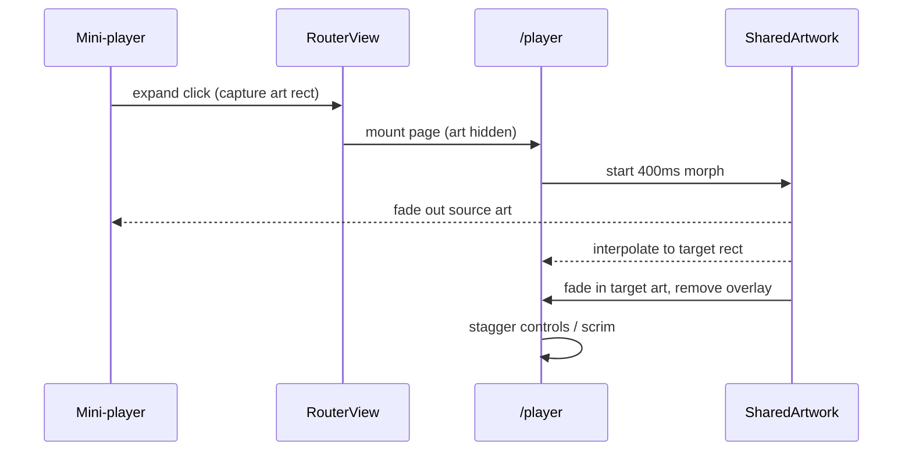

# Chordly Motion & Loading Plan

Status: proposed
Date: 2026-11-05
Parent: [UI Pages Plan](pages-plan.md)
Related: pages plan §3.1 (re-vendor GoGPU), `docs/notes/UI-NOTES.md` (UI-INT-07)

This plan defines the app's motion language, the mini-player expansion, loading
states, and the smaller transitions that make the UI feel responsive without
animating everything.

---

## 1. What the engine already provides

The pinned `github.com/gogpu/ui@v0.1.54` module ships two relevant packages
(currently **not vendored** — see `UI-INF-01` in the pages plan):

### `animation`

- `animation.NewController()` + `ctrl.Tick(ctx.DeltaTime())`.
- Tweens over `float32` signals:
  `animation.To(adapter, target).From(x).Duration(d).Ease(e).Start(ctrl)`.
- Springs: `animation.SpringTo(adapter, target).Stiffness(...).DampingRatio(...)`.
- Composition: `NewSequence`, `NewParallel`, `Stagger`, `Chain`, `RepeatForever`.
- M3 tokens: `M3Standard`, `M3Emphasized`, `M3EmphasizedDecelerate`,
  `M3EmphasizedAccelerate`, plus `DurationShort1` … `DurationExtraLong4`.
- Type tweens: `NewFloat32Tween`, `NewColorTween`, `NewPointTween`,
  `NewSizeTween`.

### `transition`

- `transition.Wrap(child, EnterEffect(FadeIn()), ExitEffect(FadeOut()), Duration(...))`
- `transition.NewFade`, `transition.NewSlide`, `FadeIn/FadeOut/SlideIn/ScaleIn`.
- Fades use `Canvas.PushOpacity` when the canvas supports `transition.OpacityPusher`.

### Frame integration rules

- **Layout-affecting** animations implement `widget.AnimationTicker`:
  `TickAnimation(ctx widget.Context)` runs before layout. Use this for the
  collapsible/expanding surfaces, not `Layout()` or `Draw()`.
- **Paint-only** animations call `ctx.ScheduleAnimationFrame()` and
  `SetNeedsRedraw(true)` from `Draw`. Use this for shimmer, spinners, equalizer
  bars, caret pulses.
- The default animation pump is **30 fps (33 ms)**. Motion must read well at
  30 fps; do not promise 60 fps in copy or acceptance criteria. A 60 fps pump
  would be a separate `UI-INF` item (window option / upstream).
- Always clamp `ctx.DeltaTime()` to ≤ 32 ms in custom tickers, as
  `core/collapsible` does, to avoid jumps after a stall.
- Never rebuild the widget tree per frame. Animate a `float32` progress signal
  and read it in `Layout`/`Draw`; `reactiveView` must not watch per-frame values.

---

## 2. Motion language

### 2.1 Durations

| Token                      | Use                                     |
| -------------------------- | --------------------------------------- |
| `DurationShort1` (50 ms)   | Hover tint, press overlay               |
| `DurationShort2` (100 ms)  | Icon color/state changes, focus ring    |
| `DurationShort3` (150 ms)  | Button press scale, sidebar pill morph  |
| `DurationShort4` (200 ms)  | Checkbox/toggle, like pop, row insert   |
| `DurationMedium1` (250 ms) | Card hover lift, page crossfade         |
| `DurationMedium2` (300 ms) | Dialog/menu, skeleton crossfade         |
| `DurationMedium4` (400 ms) | Mini-player → full player expansion     |
| `DurationLong2` (500 ms)   | Shared-element artwork travel (phase 2) |

### 2.2 Easing

| Curve                    | Use                                                          |
| ------------------------ | ------------------------------------------------------------ |
| `M3Standard`             | In-place utility changes (hover, selection, toggles)         |
| `M3StandardDecelerate`   | Entering content (page in, cards in)                         |
| `M3StandardAccelerate`   | Exiting content (page out, dialog dismiss)                   |
| `M3Emphasized`           | Hero motion: player expansion, shared elements, auth success |
| `M3EmphasizedDecelerate` | Large surfaces entering (full player)                        |
| `M3EmphasizedAccelerate` | Large surfaces exiting                                       |
| `Linear`                 | Only spinners/progress, never spatial motion                 |

### 2.3 Principles

1. **Motion explains state.** Animate where something came from or where it went
   (player expansion, page navigation). Do not animate data that simply arrives.
2. **Fast and short.** Most UI motion is 150–300 ms. Only the full player and
   shared elements reach 400 ms.
3. **No layout thrash.** Prefer transform/opacity. If layout must change, isolate
   it in one widget with `TickAnimation`, never in the page root.
4. **One focus.** Only one large animation at a time. Background loops (shimmer,
   equalizer) are quiet and stop off-screen.
5. **Interruptible.** Every animation must handle a reverse request, a route
   change, or unmount without leaving a half-drawn state.
6. **Reduced motion is first-class.** All durations collapse to 0 and decorative
   loops stop.

### 2.4 Reduced motion

- Add `state.SigReducedMotion` (bool, default `false`) and a Settings → Appearance
  toggle: “Reduce motion”.
- Central helper in `appui/motion.go`:

```go
type Motion struct{ Reduced bool }

func (m Motion) Duration(d time.Duration) time.Duration
func (m Motion) Ease(e animation.Easing) animation.Easing // Linear when reduced
func (m Motion) Enabled() bool
```

- When reduced:
  - route changes and player expansion are instant;
  - no shimmer, equalizer, floating, or staggered entrances;
  - opacity transitions, if any, ≤ 100 ms;
  - spinners may still rotate (they communicate progress), but prefer a static
    “Loading…” row on reduced motion.

---

## 3. Shared infrastructure

### 3.1 `appui/motion.go`

- Motion tokens (`MotionDurationFast`, `MotionDurationBase`, `MotionDurationSlow`).
- `Motion` helpers and a `motionNow()` clock wrapper for tests.
- `animateFloat(ctrl, value, target, from, duration, easing)` helper.
- `progressAdapter` type implementing the animation engine's `signalFloat32`
  (see `core/collapsible` for the pattern).

### 3.2 Playback / interaction signals

Add only what pages need:

```go
// internal/state
SigReducedMotion  = state.NewSignal(false)
SigPlayerMorph    = state.NewSignal[float32](0) // 0 collapsed, 1 expanded
SigToasts         = state.NewSignal([]Toast{})
```

Player progress is owned by the player transition widget, not the global state;
`SigPlayerMorph` exists for tests/debug and for the mini-player to react
(collapse its own content while the full player is open).

### 3.3 Loading kit (`appui/loading.go`)

| Component                         | Implementation                                                    |
| --------------------------------- | ----------------------------------------------------------------- |
| `Spinner(size, color)`            | `core/progress` indeterminate; themed track/indicator             |
| `InlineSpinner`                   | 16 px spinner for buttons and rows                                |
| `Skeleton(w, h, radius)`          | Custom paint-only pulse (opacity 0.35 → 0.75, 1.2 s auto-reverse) |
| `SkeletonText(lines)`             | Two/three skeleton bars                                           |
| `SkeletonTrackRows(n)`            | Art + two lines + duration                                        |
| `SkeletonCardRow(n)`              | Poster + title bars                                               |
| `SkeletonHero()`                  | Large banner block                                                |
| `ButtonLoading(label, loading)`   | Keeps width, swaps label for spinner, disables                    |
| `AsyncView[T]`                    | Wraps loading/error/data with delay + minimum display             |
| `TopProgressBar`                  | 2 px indeterminate line for refresh-with-cache                    |
| `ErrorCard(title, detail, retry)` | Error state with one action                                       |
| `OfflineBanner`                   | Slide-down banner, persistent while offline                       |

### 3.4 Loading timing rules

1. Show a skeleton only after **150 ms** of loading (avoids a flash on fast
   responses).
2. Once shown, keep it for at least **300 ms** (avoids skeleton/content flicker).
3. Crossfade skeleton → content over **200 ms** (`M3Standard`).
4. Keep previous content visible during a refresh; use `TopProgressBar` instead
   of replacing the page.
5. Search keeps previous results while the next query loads; a small inline
   spinner appears in the results header.
6. Errors replace the spinner after the request timeout (12–15 s) with a retry.
7. Optimistic actions (like, queue add) update immediately; roll back with a
   toast if the request fails.

---

## 4. Mini-player → full player expansion

### 4.1 UX

- Trigger: expand button in the bottom player, clicking album art, or `Enter`
  with the player focused.
- Destination: `/player` (see pages plan §4.9).
- Collapse: down chevron, `Escape`, `Router.Back`, or a downward drag on the
  player header.
- Playback never stops, restarts, or changes track during the transition.
- The mini-player remains mounted (hidden/collapsed) so the scrubber/audio state
  is not recreated.

### 4.2 Phase 1 (ship first): route entrance animation

No shared-element geometry yet; this is the robust 80% version.

Timeline (`M3EmphasizedDecelerate` unless noted):

| Time       | Layer             | Motion                                                            |
| ---------- | ----------------- | ----------------------------------------------------------------- |
| 0 ms       | scrim             | opacity 0 → 0.55 over 200 ms                                      |
| 0 ms       | player panel      | translate Y +28 px → 0, opacity 0 → 1 over 250 ms                 |
| 0–300 ms   | artwork           | scale 0.92 → 1.0, opacity 0 → 1 (`DurationMedium2`)               |
| 60 ms      | title/artist      | translate Y +8 px → 0, opacity 0 → 1 over 200 ms                  |
| 100–220 ms | transport         | fade/slide up with 20 ms stagger per control                      |
| 160 ms     | queue/lyrics tabs | fade in over 200 ms                                               |
| 200 ms     | mini-player       | height/opacity collapse to 0 over 180 ms (`M3StandardAccelerate`) |

Collapse reverses the panel motion over 250 ms, then `Router.Back()`.

Implementation:

- `appui/player_view.go`: full-screen layout, uses `animation.Controller`.
- On mount, start an entrance `ParallelBuilder` (or one progress signal with
  staggered tween offsets).
- Wrap the page content in a `transition.Fade`/`Slide` only if it does not fight
  the custom stagger.
- Set `state.IsPlayerExpanded`/`SigPlayerMorph` for the mini-player to hide.
- Follow the `TickAnimation` rule: the panel is laid out at final size; only
  paint transforms/opacity animate, so no per-frame relayout.

### 4.3 Phase 2: shared-element artwork morph

After Phase 1 is stable:

1. On expand, capture the mini-player art rect and the target art rect from the
   player page (`Layout`).
2. Keep the player page's art hidden for the duration of the morph.
3. Draw a `SharedArtwork` overlay above both pages:
   - rect interpolated with `animation.M3Emphasized` over 400 ms;
   - corner radius 12 → 28;
   - content (placeholder art, then real image) crossfades at 50% progress.
4. Title/artist fade out on the mini-player and fade in on the player with a
   40 ms overlap.
5. On collapse, reverse with 300 ms `M3EmphasizedAccelerate`; hide the overlay and
   show the real mini-player art in the final frame.



### 4.4 Drag to dismiss

- Pointer down on the player header or art starts a drag.
- `progress = 1 - clamp(dragY / availableHeight, 0, 1)`; scrim and offsets follow
  the same progress.
- Release:
  - if `progress < 0.6` or downward velocity > 700 px/s → dismiss;
  - else settle back.
- Use `animation.SpringTo(progress, target)` with `StiffnessMedium` and
  `DampingLowBouncy` for the settle; a tween is acceptable for the dismiss.
- During drag, cancel any running tween; on `Unmount`, stop the controller.

### 4.5 Edge cases and acceptance

- Expand then immediately collapse: no duplicate pages, no stuck scrim.
- Navigate to another route during expansion: animation cancels and the router
  owns the final state.
- Reduced motion: instant `/player` navigation, no scrim fade.
- 30 fps budget: panel, art, title, and controls animate within one frame tick;
  no tree rebuilds.
- Back/forward: `/player` is a real route, so history works.

---

## 5. Loading states per page

| Page           | Skeleton / loading                                           | Notes                                                  |
| -------------- | ------------------------------------------------------------ | ------------------------------------------------------ |
| Home           | `SkeletonHero`, `SkeletonCardRow(5)`, `SkeletonTrackRows(2)` | Show cached content while refreshing; top progress bar |
| Search         | Keep old results; inline spinner in header                   | 300 ms debounce already exists                         |
| Album          | Skeleton cover + title bars + 8 track rows                   | Header and rows animate in together                    |
| Artist         | Skeleton header + rows + card row                            | Top songs first                                        |
| Playlist / Mix | Skeleton cover + rows                                        | Private/unavailable uses `ErrorCard`                   |
| Library tabs   | Skeleton rows per tab                                        | Guest state is not a loading state                     |
| Queue          | No skeleton                                                  | Local state; optimistic updates                        |
| Login          | Button spinner + “Checking with YouTube Music…” card         | Never blank the page                                   |
| Lyrics         | “Finding lyrics…” card + spinner                             | Already has text state; add spinner and fade           |
| Player         | Art placeholder pulse until stream metadata arrives          | Do not block playback controls                         |

Buffering:

- When `PlaybackStatus == Buffering`, show a thin indeterminate line above the
  mini-player and a subtle pulse on the scrubber fill.
- Do not spin the large play/pause button; it remains interactive.
- Stop the buffering indicator immediately on `Playing` or `Paused`.

Images:

- Album art placeholders use `Skeleton` with the dominant-color tint until the
  image loads, then crossfade over 200 ms.
- If artwork fails, keep a deterministic color derived from the track ID.

---

## 6. Other animations

### 6.1 Navigation

- Route transitions: 200 ms crossfade + 8 px slide (`M3StandardDecelerate` enter,
  `M3StandardAccelerate` exit).
- Back reverses the direction.
- Detail pages (album/artist/playlist) slide from the right; sidebar destinations
  crossfade only.
- `routerView` needs a small transition state machine: keep the outgoing child
  for the exit duration, draw both with `Canvas.PushOpacity`, then unmount the old
  child. Do not unmount immediately as it does today.
- Reduced motion: swap instantly.
- Initial app load does not animate.

### 6.2 Sidebar

- Active indicator: 150 ms background/foreground color tween; a sliding pill
  behind the active icon (phase 2) instead of a hard switch.
- Hover: 80–100 ms tint.
- Settings/Account chip at the bottom: avatar ring pulses once after sign-in.

### 6.3 Buttons, cards, rows

- Press: scale 0.98 for icon buttons, 0.96 for large pills, 100 ms.
- Hover: surface tint 80 ms; cards lift 1–2 px and scale 1.01 over 150 ms.
- Card art zooms 1.03 on hover with clipping.
- Row hover: 100 ms background fade.
- Disabled states never animate.
- Animate paint state only; do not change layout on hover.

### 6.4 Like / favorite

- Icon: color tween to `ColorHeartActive` over 150 ms + scale pop
  0.8 → 1.15 → 1.0 (spring, 250 ms).
- On unlike: quick 120 ms fade back; no pop.
- Reduced motion: instant color change.

### 6.5 Queue

- Insert: height 0 → measured height + opacity 0 → 1 over 200 ms
  (`M3StandardDecelerate`); cap to visible rows.
- Remove: reverse over 150 ms, then re-layout.
- Reorder: lifted row scale 1.02 and shadow; drop settles with a 150 ms tween.
- Now-playing equalizer: four bars, paint-only, 1.1 s loop, phase offsets; runs
  only for the active row and only while `Playing`. Stop on `Paused`.

### 6.6 Lyrics

- Active line: color opacity + scale 1.0 → 1.04 over 150 ms.
- Scroll: current `0.18` lerp is acceptable; switch to a 250 ms tween between
  target offsets to avoid continuous idle redraws.
- Click-to-seek: a brief 120 ms underline flash confirms the action.
- Reduced motion: instant highlight and scroll jump.

### 6.7 Theme switch

- Palette change should LERP over 250 ms (see UI-INT-07). Do **not** rebuild the
  shell per frame; use paint-time palette reads.
- Reduced motion: instant palette swap.
- Crossfade the album-art tint separately over 300 ms.

### 6.8 Dialogs, toasts, auth

**Toast baseline shipped** in `appui/toast.go` (TSK-221): 200 ms enter /
160 ms exit, 3 s info/success, 5 s warning, 6 s error, click-to-dismiss, and a
four-toast stack above the mini-player. Remaining for UI-MOTION-08: replace the
local timings with `Motion` tokens and disable the slide under reduced motion.

- Dialog: scrim fade 150 ms; panel scale 0.96 → 1 + fade 200 ms
  (`M3EmphasizedDecelerate`); dismiss reverses in 150 ms.
- Toast/snackbar: slide up 12 px + fade in 200 ms, auto-dismiss 4 s, slide down
  out 150 ms. One toast at a time; queue the rest.
- Auth success checkmark: scale 0.6 → 1 with a 300 ms emphasized spring; hold
  800 ms before navigating.
- Error shake: avoid; use color + icon instead.

### 6.9 Empty states

- Illustration fades/slides in 200 ms on first show.
- No infinite floating loops (distracting and wastes frames). If a subtle loop is
  desired, it must stop after 3 cycles and respect reduced motion.

---

## 7. Performance and implementation rules

1. **No per-frame tree rebuilds.** Animate signals read in `Draw`/`Layout`.
2. **One controller per component.** Call `ctrl.CancelAll()` in `Unmount`.
3. **Layout-affecting motion** implements `TickAnimation`; paint-only motion uses
   `ScheduleAnimationFrame`. Never mutate layout inside `Draw`.
4. **Clamp delta time** to 32 ms; ignore frames smaller than 1 ms.
5. **Stop off-screen loops.** Shimmer/equalizer check `IsVisible()` and the
   current route; `Unmount` cancels.
6. **Cap concurrent animations.** At most one large transition, one shimmer per
   page, one equalizer loop.
7. **30 fps budget.** Use M3 durations; avoid very short 50 ms spatial moves that
   only get 1–2 frames. 100 ms is the practical minimum for visible movement.
8. **Do not animate** playhead position, volume level, lyric timestamps, or
   network progress values that update from real time; smooth only the painted
   knob/indicator, never the underlying value.
9. **Cancellation on navigation.** Router changes and player collapse must cancel
   tweens and settle to the correct end state synchronously.
10. **Test hooks.** Expose `motion.SetReducedForTests(true)` or a build tag so
    tests never wait on wall-clock animation.

---

## 8. Task breakdown

| Task ID        | Description                                                             | File scope                                                                                  | Depends on                          | Acceptance                                                     |
| -------------- | ----------------------------------------------------------------------- | ------------------------------------------------------------------------------------------- | ----------------------------------- | -------------------------------------------------------------- |
| `UI-MOTION-01` | Motion tokens, `Motion` helper, `SigReducedMotion`, settings toggle     | `appui/motion.go`, `internal/state/state.go`, `appui/settings_view.go`                      | none                                | reduced-motion collapses durations; toggle persists in-session |
| `UI-MOTION-02` | Loading kit: spinner, skeleton, `AsyncView`, error/offline cards        | `appui/loading.go`, `appui/components.go`                                                   | UI-INF-01                           | 150 ms delay + 300 ms minimum; no flicker                      |
| `UI-MOTION-03` | Page transitions in `routerView` (fade + slide, outgoing page retained) | `appui/routerview.go`                                                                       | UI-MOTION-01                        | back/forward correct; no leak; reduced motion instant          |
| `UI-MOTION-04` | Mini-player → `/player` Phase 1 entrance/collapse                       | `appui/player_view.go`, `appui/bottom_player.go`, `main.go`                                 | UI-MOTION-01, pages plan UI-PAGE-07 | expand/collapse works, playback uninterrupted                  |
| `UI-MOTION-05` | Shared-element artwork morph (Phase 2) + drag-to-dismiss                | `appui/player_transition.go`                                                                | UI-MOTION-04                        | 400 ms morph, spring settle, cancel-safe                       |
| `UI-MOTION-06` | Micro-interactions: buttons, cards, sidebar, like, rows                 | `appui/components.go`, `appui/sidebar.go`, `appui/made_for_you.go`, `appui/new_releases.go` | UI-MOTION-01                        | hover/press at 100–150 ms; no layout changes                   |
| `UI-MOTION-07` | Equalizer, queue insert/remove, lyrics highlight                        | `appui/up_next.go`, `appui/queue_view.go`, `appui/lyrics_view.go`                           | UI-MOTION-01                        | loops stop when paused/off-screen                              |
| `UI-MOTION-08` | Toasts, dialogs, auth success                                           | `appui/toast.go`, `appui/signin_view.go`, `appui/components.go`                             | UI-MOTION-02                        | one toast at a time; dialog reversal works                     |
| `UI-MOTION-09` | Theme LERP (paint-time)                                                 | `appui/shell.go`, `internal/theme/*`                                                        | UI-INT-07                           | 250 ms transition without tree rebuild                         |
| `UI-MOTION-10` | Motion audit + performance pass                                         | all `appui/*`                                                                               | all above                           | checklist below passes at 30 fps                               |

---

## 9. Test and review checklist

Automated:

- Reduced-motion helper returns zero durations / linear easing.
- Player morph progress reaches 0 and 1 and cancels cleanly on unmount.
- Router transition state machine: enter → settle → exit; no double children
  after completion.
- Skeleton timing helper: 150 ms delay, 300 ms minimum hold.
- Existing `go test ./appui` and race tests stay green.

Manual (run the app):

1. Expand mini-player: scrim, panel, art, title, controls enter in one motion;
   audio never stutters.
2. Collapse via button/Escape/back/drag: no stuck overlay, mini-player restored.
3. Rapidly toggle expand/collapse 5 times: state settles correctly.
4. Home first load: no skeleton flash under 150 ms; skeleton holds long enough
   to read; content fades in.
5. Search: previous results stay visible during a new query.
6. Like a track: pop + color, no layout shift.
7. Queue insert/remove: rows animate, list remains scrollable.
8. Pause playback: equalizer stops.
9. Theme switch: colors LERP smoothly, no per-frame shell rebuild.
10. Enable Reduce motion: all of the above become instant; no loops.
11. Leave a page with active animations: no CPU/pump activity afterwards.

---

## 10. Risks and open questions

### Risks

- **30 fps pump** limits very short spatial motion; keep movements ≥ 100 ms.
- **Layout-affecting expansion** can cause jank if scaled to the whole shell.
  Phase 1 avoids this by animating paint transforms inside `/player`.
- **Per-frame rebuild temptation**: `reactiveView` rebuilds are cheap for static
  sections but must never be driven by animation signals.
- **Shared-element complexity**: artwork morph requires an overlay layer and
  careful cancellation; Phase 1 delivers the UX without it.
- **Reduce motion / accessibility**: loops and parallax are the first things to
  disable; test keyboard flows with animations off.

### Open questions

1. Should the full player be a route (`/player`, recommended) or an in-place
   expanding sheet over the shell?
2. Do we want a 60 fps animation pump for the player transition? That requires a
   window/desktop option and is out of scope for this plan.
3. Should the mini-player keep rendering (collapsed) under `/player` or hide
   completely? Recommendation: keep it mounted to preserve scrubber state.
4. Is drag-to-dismiss required in v1, or can Phase 1 ship button/Escape/back only?
5. Do we animate album-art images once real thumbnails land, or keep the current
   vector placeholders? The plan assumes a 200 ms crossfade for either.
