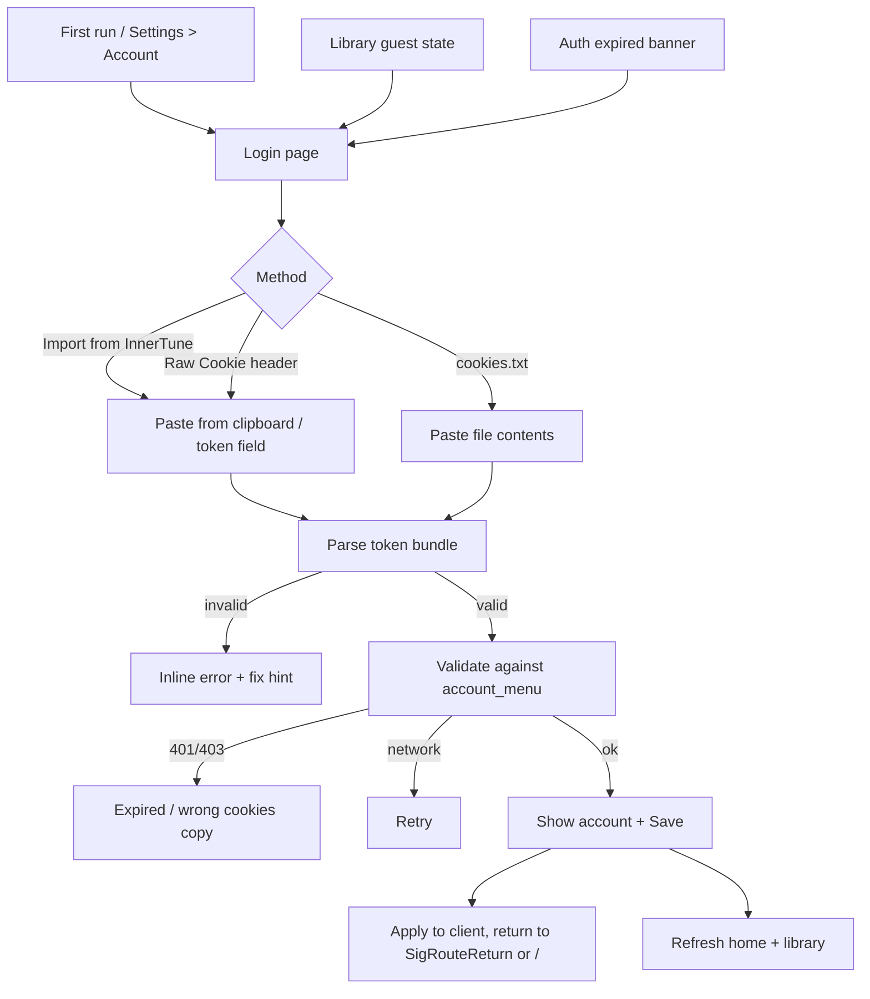

# Google Sign-In & InnerTune Session Import — Plan

Status: proposed
Date: 2026-11-05
Parent doc: [UI Pages Plan](pages-plan.md) (routes, phasing, shared components)

---

## 1. Goals and non-goals

### Goals

- One clear page (`/login`) where a user can connect a YouTube Music account.
- **First-class “Import from InnerTune”**: accept a session exported from
  InnerTune (cookie header / token bundle) without asking the user to edit code.
- Accept the common fallbacks: raw `Cookie:` header, Netscape `cookies.txt`,
  and a short JSON token bundle.
- Validate the session against YouTube Music before saving it, show the account
  identity, and let the user sign out or re-import later.
- Keep every credential out of logs, UI history, and plaintext SQLite.

### Non-goals (v1)

- Google OAuth / “Sign in with Google” via OAuth 2.0 access tokens. InnerTube
  account endpoints do not accept them (see §2).
- Multi-account switching (single active account; P2).
- An embedded browser (P2, and Google may block embedded user agents).
- Refreshing rotated cookies on the user’s behalf (best-effort capture only).

---

## 2. Why this is cookie import, not OAuth

YouTube Music’s private `WEB_REMIX` InnerTube endpoints authenticate with a
**Google web session**, not with an OAuth bearer token:

- The client sends the account’s `Cookie` header (notably `SAPISID`,
  `__Secure-3PAPISID`, `SID`, `HSID`, `SSID`, `APISID`, `LOGIN_INFO`,
  `VISITOR_INFO1_LIVE`, `PREF`).
- It computes an `Authorization: SAPISIDHASH …` header from that cookie.
- It sends `X-Goog-AuthUser: 0` and the visitor ID.

An OAuth access token (`ya29.*`) from Google Identity is **not** accepted by
these endpoints. Therefore the UI must not promise a normal OAuth button. The
honest flow is “connect your existing YouTube Music session”, with InnerTune and
browser cookie exports as the supported sources.

> Copy shown in the app: “Chordly uses your existing YouTube Music session.
> Import it from InnerTune or paste a cookie export. Chordly never sees your
> Google password.”

---

## 3. Entry points and flow



Entry points:

1. Settings → Account → “Sign in”.
2. Library guest state → “Import from InnerTune”.
3. Auth-expired banner anywhere → “Re-import session”.
4. Optional first-run prompt after onboarding (guest-first recommendation).

Post-login return:

- `state.SigRouteReturn` stores the path that triggered login.
- After success, `Router.Navigate(SigRouteReturn)`; fallback `/`.

---

## 4. Page design (`/login`)

### Layout

```text
┌──────────────────────────────────────────────────────────────┐
│  [← Back]                                                    │
│                                                              │
│  Connect YouTube Music                                       │
│  Sign in to sync favorites, playlists and history.           │
│                                                              │
│  ┌──────────────────────────────┐  ┌───────────────────────┐ │
│  │ Import from InnerTune        │  │ Already have cookies? │ │
│  │ Paste your InnerTune session │  │ Paste a Cookie header │ │
│  │ [Paste from clipboard]       │  │ or cookies.txt        │ │
│  │ ┌──────────────────────────┐ │  │ ┌───────────────────┐ │ │
│  │ │ masked token field       │ │  │ │ paste field       │ │ │
│  │ └──────────────────────────┘ │  │ └───────────────────┘ │ │
│  │ [Import]                     │  │ [Validate]            │ │
│  └──────────────────────────────┘  └───────────────────────┘ │
│                                                              │
│  ▸ How to copy a session from InnerTune                      │
│  ▸ Open music.youtube.com in a browser (instructions)        │
│                                                              │
│  [Continue as guest]                                         │
└──────────────────────────────────────────────────────────────┘
```

After validation:

```text
┌──────────────────────────────────────────────────────────────┐
│  ✓ Session valid                                             │
│  (avatar)  Display Name  @handle                            │
│            Source: Imported from InnerTune                   │
│            Expires: unknown / re-import if requests fail     │
│                                                              │
│  [Save and continue]        [Use a different session]        │
└──────────────────────────────────────────────────────────────┘
```

### States

| State           | UI                                                                 |
| --------------- | ------------------------------------------------------------------ |
| Idle            | Method cards, guest option, instructions                           |
| Parsing         | Button spinner, fields disabled                                    |
| Invalid format  | Inline error naming what is missing (`SAPISID`, cookie header, …)  |
| Validating      | “Checking with YouTube Music…”                                     |
| Invalid/expired | “These cookies were rejected. Copy a fresh session and try again.” |
| Network error   | “Couldn’t reach YouTube Music.” + Retry (token kept in memory)     |
| Success         | Account identity + Save                                            |
| Saving          | Spinner, then navigate                                             |

### Token display rules

- Never render the full cookie/token after import.
- Show a summary: `SAPISID ••••AB12`, `14 cookies`, `visitorData present/absent`.
- Short tokens use a masked text field; long cookie headers are read from the
  clipboard or a pasted multi-line field. Clear the field on success and on
  leaving the page.

---

## 5. Import methods

### 5.1 Import from InnerTune (primary)

InnerTune keeps a logged-in Android WebView cookie jar for `youtube.com` /
`google.com`; it does not publish a stable “token file” format. Chordly therefore
accepts the session in the shapes users actually have:

1. The cookie string from InnerTune/WebView tooling (header form).
2. A JSON token bundle exported by a helper.
3. A Netscape `cookies.txt` produced from the same session.

UI steps:

1. Tap **Paste from clipboard** (uses `widget.ClipboardRead()`); the raw value is
   parsed and discarded immediately.
2. Or paste a short JSON/base64 token into the masked field.
3. Tap **Import**. The page validates and shows the account.
4. On success, the session is stored in the OS keyring; the original text is
   zeroed from UI state.

If a future InnerTune backup format is identified, add it as a parser adapter
(§6.4) without changing the page.

#### Accepted InnerTune payloads

Raw cookie header (most common):

```text
SID=<value>; HSID=<value>; SSID=<value>; APISID=<value>; SAPISID=<value>;
__Secure-3PSID=<value>; __Secure-3PAPISID=<value>; __Secure-3PSIDTS=<value>;
LOGIN_INFO=<value>; VISITOR_INFO1_LIVE=<value>; PREF=<value>
```

JSON bundle (helper export / future InnerTune backup):

```json
{
  "source": "innertune",
  "cookie": "SID=...; HSID=...; SAPISID=...; __Secure-3PSID=...",
  "visitorData": "Cgt...",
  "authorization": null,
  "accountName": "optional display hint"
}
```

Accepted aliases: `cookie`, `cookieHeader`, `cookies`, `session`, `token`,
`authorization`, `visitorData` / `visitor_data`, `sapisid`.
A JSON array of `{name, value, domain}` objects is also accepted.

### 5.2 Raw Cookie header

- Accept `Cookie: name=value; …` or the bare `name=value; …` string.
- Required: at least one of `SAPISID` / `__Secure-3PAPISID`.
- Recommended: `__Secure-3PSID`, `__Secure-3PSIDTS`, `SID`, `HSID`, `SSID`,
  `APISID`, `LOGIN_INFO`.
- Missing recommended cookies produce a **warning**, not a hard failure, unless
  validation fails.

### 5.3 `cookies.txt` (Netscape format)

- Tab-separated: `domain  includeSubdomains  path  secure  expiry  name  value`.
- Filter to `youtube.com`, `music.youtube.com`, `google.com` (including
  `__Secure-*` names).
- Merge duplicate names by preferring the longest expiry.
- Accept `#HttpOnly_` prefixes.
- v1 text input: paste the file contents. File picker/drag-drop is P1.

### 5.4 Short token / JSON

Accepted keys (case-insensitive): `cookie`, `cookieHeader`, `cookies`,
`session`, `token`, `authorization`, `visitorData`, `visitor_data`, `sapisid`,
`dataSyncId`, `accountName`.
A JSON array of `{name, value, domain}` cookie objects is also accepted.
Base64 input is decoded once and re-detected.

### 5.5 Browser instructions (P2 embedded browser)

- Explain that YouTube login must happen in a real browser session, and that
  copying cookies is the supported desktop path.
- P2 may integrate a WebView with a real desktop UA. Risks: Google blocks
  embedded user agents, CGO/system dependencies, credential handling. Do not
  block v1 on this.

---

## 6. Token bundle model and parser

### 6.1 Model

```go
package ytm

type TokenBundle struct {
    Cookie       string // "name=value; name2=value2"
    Authorization string // optional precomputed header
    VisitorData  string // optional X-Goog-Visitor-Id
    SAPISID      string // derived from cookie when absent
    Source       TokenSource // InnerTune | CookiesTxt | CookieHeader | JSON
}

type TokenSource string

const (
    TokenSourceInnerTune    TokenSource = "innertune"
    TokenSourceCookiesTxt   TokenSource = "cookies_txt"
    TokenSourceCookieHeader TokenSource = "cookie_header"
    TokenSourceJSON         TokenSource = "json"
)
```

### 6.2 Detection order

```text
trim BOM/whitespace
if empty -> ErrEmpty
if begins with "ya29." -> ErrOAuthTokenUnsupported (explain)
if starts with '{' or '[' -> parse JSON cookie bundle
if looks like base64 -> decode once, restart detection
if contains "Netscape HTTP Cookie File" or tab-separated cookie rows -> cookies.txt
if contains "Cookie:" -> strip header prefix, parse cookie string
if contains "=" and ";" (or a known cookie name) -> cookie header
else -> ErrUnrecognized
```

Parsing must be table-driven and never panic on adversarial input. Cap input
size (for example 2 MiB) before parsing.

### 6.3 Required cookies

| Cookie                           | Requirement          | Purpose                   |
| -------------------------------- | -------------------- | ------------------------- |
| `SAPISID` or `__Secure-3PAPISID` | **Required**         | Builds `SAPISIDHASH`      |
| `__Secure-3PSID`                 | Strongly recommended | Account session           |
| `__Secure-3PSIDTS`               | Recommended          | Rotating timestamp cookie |
| `SID`, `HSID`, `SSID`, `APISID`  | Recommended          | Legacy session set        |
| `LOGIN_INFO`                     | Optional             | Some account endpoints    |
| `VISITOR_INFO1_LIVE`             | Optional             | Visitor consistency       |
| `PREF`                           | Optional             | Locale/consent            |

If `SAPISID` is absent but `__Secure-3PAPISID` exists, derive `SAPISID` from it.
If neither exists, fail with a list of what is missing.

### 6.4 Adapter registry

```go
type TokenParser interface {
    Name() string
    CanParse(raw []byte) bool
    Parse(raw []byte) (*TokenBundle, error)
}
```

Register `cssCookie`, `netscape`, `json`, `base64`, and a future `innertuneBackup`
adapter. The page only calls `ParseToken(raw)`; adding a format does not touch UI.

---

## 7. Validation

### 7.1 Request

- `POST https://music.youtube.com/youtubei/v1/account/account_menu`
- Body: normal `WEB_REMIX` context (`hl`, `gl`, `visitorData` if present).
- Headers: `Cookie`, `Authorization` (computed), `X-Goog-AuthUser: 0`,
  `Origin: https://music.youtube.com`, `Referer: https://music.youtube.com/`,
  `X-Goog-Visitor-Id` when known.

### 7.2 Result

Parse the account name, handle/channel ID, and avatar from
`account_menu` / `accountItemRenderer`. If the endpoint shape changes, fall back
to an authenticated `FEmusic_library_landing` browse and treat HTTP 200 as
valid with a generic “YouTube Music account” label.

### 7.3 Failure mapping

| Condition                | UI                                                       |
| ------------------------ | -------------------------------------------------------- |
| HTTP 401/403             | Invalid or expired cookies                               |
| HTTP 429                 | Rate limited — wait and retry                            |
| 5xx / timeout            | Network/YouTube issue — Retry                            |
| 200 but no account block | Valid session, unknown identity; allow save with warning |
| Cookie set incomplete    | Show missing names before making a request               |

Never send the raw token to any third-party endpoint. Only
`music.youtube.com/youtubei` is contacted.

---

## 8. Client integration

Extend `internal/ytm/client.go`:

```go
func (c *Client) SetAuth(bundle *TokenBundle)   // nil clears
func (c *Client) AuthStatus() AuthStatus
```

Per request, snapshot the bundle under a mutex and inject:

- `Cookie: <bundle.Cookie>`
- `Authorization: SAPISIDHASH <ts>_<sha1(ts + " " + sapisid + " " + origin)>`
- `X-Goog-AuthUser: 0`
- `X-Goog-Visitor-Id: <bundle.VisitorData or client visitor>`
- `Origin` / `Referer`.

`SAPISIDHASH` details:

```text
ts     = unix seconds
origin = "https://music.youtube.com"
hash   = SHA1(ts + " " + SAPISID + " " + origin)
header = "SAPISIDHASH " + ts + "_" + hex(hash)
```

Prefer `__Secure-3PAPISID` when available and optionally emit matching
`SAPISID1PHASH` / `SAPISID3PHASH` using `__Secure-1PAPISID` /
`__Secure-3PAPISID`. Keep the hash computation in one function with an
injectable clock for tests.

On any 401/403 from an authenticated call:

1. Set `SigAuthStatus = Expired`.
2. Show the re-import banner.
3. Keep the app usable as a guest; do not retry in a loop.

---

## 9. Secure storage

| Data                                                                        | Storage                                                           |
| --------------------------------------------------------------------------- | ----------------------------------------------------------------- |
| Cookie bundle + derived SAPISID                                             | OS keyring (Secret Service / Keychain / Credential Manager)       |
| Fallback                                                                    | `~/.config/chordly/auth.json`, mode `0600`, explicitly documented |
| Account display name/handle/avatar URL, source, importedAt, lastValidatedAt | SQLite `settings` (no secret)                                     |
| Visitor data                                                                | Non-secret; may live with metadata                                |

Rules:

- Never log the cookie, SAPISID, authorization header, or raw import text.
- Never place the token in SQLite, crash reports, URLs, or clipboard history.
- Clear the input buffer after parsing success/failure.
- Sign out: delete the keyring entry, clear metadata, clear client auth, set
  `Guest`, refresh pages to guest state.
- Provide a “Delete imported session” confirmation with explicit copy.

Keyring dependency: `github.com/zalando/go-keyring` (or
`github.com/99designs/keyring`) — pure-Go wrappers; verify Linux Secret Service
availability and provide the 0600-file fallback with a warning.

---

## 10. Expiry, rotation, and re-import

- `__Secure-3PSIDTS` rotates; imported bundles can expire in hours or days even
  when the account is fine.
- Show **session health** on `/account`:
  - `Valid` (last validation ok, < 24 h)
  - `Stale` (validated > 7 days ago)
  - `Expiring` (missing rotating cookies)
  - `Expired` (401/403 observed)
- On `Expired`, open `/login` with the InnerTune method preselected and keep the
  previous account label visible.
- Optional later: capture `Set-Cookie` from authenticated responses and persist
  rotations. This is best-effort and must never break playback if it fails.

---

## 11. Error copy

| Situation    | Copy                                                                                               |
| ------------ | -------------------------------------------------------------------------------------------------- |
| Empty input  | “Paste your InnerTune session or a Cookie header first.”                                           |
| No SAPISID   | “That session is missing SAPISID / \_\_Secure-3PAPISID. Copy the full cookie header.”              |
| Unrecognized | “That doesn’t look like cookies or a token bundle. Use ‘Paste from clipboard’.”                    |
| OAuth token  | “Google OAuth tokens don’t work with YouTube Music. Import the browser/InnerTune session instead.” |
| 401/403      | “YouTube Music rejected this session. It may have expired — copy a fresh one.”                     |
| 429          | “YouTube Music is rate limiting sign-in. Wait a minute and retry.”                                 |
| Network      | “Couldn’t reach YouTube Music. Check your connection and retry.”                                   |
| Success      | “Connected as {name}. Your library will sync in the background.”                                   |

---

## 12. Tests

1. **Parser fixtures** (no network): cookie header, `Cookie:` prefix, Netscape,
   JSON object, JSON cookie array, base64-wrapped JSON, missing SAPISID,
   `ya29.` OAuth token, garbage, oversized input.
2. **SAPISIDHASH golden test** with a fixed timestamp and known cookie.
3. **Mock account menu**: 200 with account payload, 401, 429, 500, timeout.
4. **Storage**: keyring mock round-trip; sign-out deletes secrets; metadata
   contains no cookie value.
5. **UI states**: invalid input shows inline error; success card masks the token;
   paste button reads clipboard provider; guest option navigates back.
6. **Client injection**: authenticated request includes Cookie, Authorization,
   `X-Goog-AuthUser`, Origin; unauthenticated request does not.

No test may contain a real credential. Use obviously fake values.

---

## 13. Tasks

| Task ID      | Description                                                      | File scope                                                  | Depends on            | Acceptance                              |
| ------------ | ---------------------------------------------------------------- | ----------------------------------------------------------- | --------------------- | --------------------------------------- |
| `UI-AUTH-01` | Bundle model, adapters, detection, required-cookie checks        | `internal/ytm/token.go`, `token_test.go`                    | none                  | fixtures pass; no panics                |
| `UI-AUTH-02` | `AuthService`, SAPISIDHASH, account_menu validation, auth status | `internal/ytm/auth.go`, `internal/ytm/client.go`, tests     | UI-AUTH-01            | mock server validates; headers asserted |
| `UI-AUTH-03` | Secure store + metadata + sign out                               | `internal/auth/store.go`, `internal/cache/db.go` (additive) | UI-AUTH-02            | keyring round-trip; secret not in DB    |
| `UI-PAGE-01` | Sign-in page and import methods                                  | `appui/signin_view.go`, `appui/login_page.go`, `main.go`    | UI-INF-01, UI-AUTH-03 | paste import end-to-end                 |
| `UI-PAGE-02` | Account page, session health, re-import                          | `appui/account_view.go`, `appui/sidebar.go`                 | UI-AUTH-03            | sign out + re-import work               |
| `UI-PAGE-03` | Library guest CTA + auth-expired banner                          | `appui/library_view.go`, `appui/components.go`              | UI-PAGE-01            | guest CTA opens login and returns       |

---

## 14. Risks and open questions

### Risks

- **Credential exposure** is the highest risk. Keyring-first storage, strict
  logging bans, and masked UI are mandatory.
- **Account safety**: automated clients can trigger Google challenges. Warn users
  that this is an unofficial client, and never retry aggressively.
- **Cookie rotation** makes static imports fragile. Set expectations in the UI and
  provide one-tap re-import.
- **Google may reject embedded WebViews**; do not make them the only path.
- **GPL/API changes**: InnerTune’s storage layout can change between releases.
  Keep the adapter approach and treat unknown formats as “paste a Cookie header”.

### Open questions

1. Does the product want to support a specific InnerTune backup JSON, or is the
   cookie header the expected export? (Plan supports both behind adapters.)
2. Should the imported session be shared with the OS keyring on first run, or
   only after the user taps Save?
3. Is a native file picker acceptable as a dependency for `cookies.txt`, or is
   clipboard-only enough for v1?
4. Should `/login` be shown automatically on first launch when the home feed has
   no personalized data?
5. Multi-account: is one active account enough for the first release?
