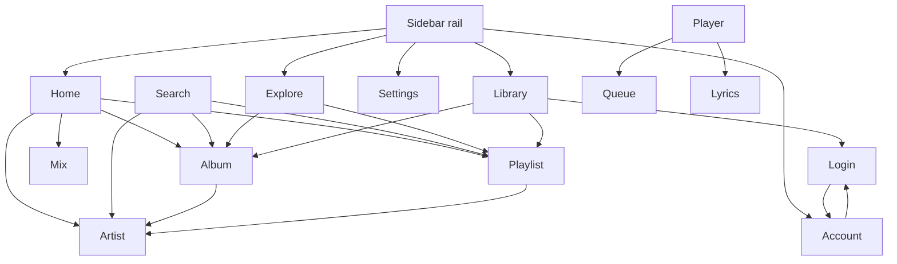

# Chordly UI Pages Plan

Status: proposed
Date: 2026-11-05
Companion doc: [Google Sign-In & InnerTune import](auth-signin-plan.md)

This plan inventories the pages Chordly is supposed to have, marks what exists
today, and defines the missing routes, layouts, states, dependencies, and task
order. It is scoped to presentation (`appui`) plus the minimum backend/state work
needed to feed each page.

---

## 1. Current inventory

Routes are registered in `main.go`; pages live in `appui/`.

| Route | Page builder | State | Notes |
| --- | --- | --- | --- |
| `/` | `HomePage` → `NewHomeContent` | Implemented | Hero, Made for you, New releases |
| `/explore` | `HomePage` | **Placeholder** | No explore content; reuses home |
| `/library` | `HomePage` | **Placeholder** | No library, favorites, history, downloads |
| `/search` | `SearchPage` | Implemented | Top-bar query; filter pills |
| `/queue` | `QueuePage` | Implemented | Reactive list, clear queue |
| `/lyrics` | `LyricsPage` | Implemented | Overlay page, fetch on mount |
| `/settings` | `SettingsPage` | Partial | Appearance only, plus static playback/about |
| `/album/:id` | — | **Missing** | No detail page |
| `/artist/:id` | — | **Missing** | No detail page |
| `/playlist/:id` | — | **Missing** | No detail page |
| `/mix/:id` | — | **Missing** | Mix cards are non-navigating |
| `/player` | — | **Missing** | Expand toggles a signal only |
| `/login` | — | **Missing** | **Critical: Google sign-in + InnerTune token import** |
| `/account` | — | **Missing** | No account/profile surface |
| `*` | `NotFoundPage` | Implemented | Light demo styling |

Unreachable demo pages still sit in `appui/pages.go` (`ProjectsPage`,
`ProjectPage`, `ChordsPage`, `ChordPage`, project/chord catalogs). Delete them
when the real detail pages land.

### Navigation gaps

- Nav rail has Home / Explore / Library / Settings only; no account or sign-in entry.
- Mix cards (`appui/made_for_you.go`) have empty click handlers.
- New-release rows, queue rows, search result rows, and up-next rows have no
  navigation to album/artist/playlist.
- Bottom-player expand toggles `state.IsFullscreen` but no full-screen route exists.
- `SettingsPage` is a single page; audio/cache/plugin controls have no home.

---

## 2. Target route tree

```text
/
/explore
/search
/album/:albumID
/artist/:artistID
/playlist/:playlistID
/mix/:playlistID
/library
  /library/favorites
  /library/playlists
  /library/history
  /library/downloads
/player
/lyrics
/queue
/login
  /login/import          (deep-link into the token/cookie import step)
/account
/settings
  /settings/appearance
  /settings/playback
  /settings/storage
  /settings/plugins
  /settings/account
  /settings/about
*                        (not-found)
```

`/explore` and `/library` stay top-level rail destinations. Detail pages are
nested siblings of `/search`, not children of it, so links work from any page.

Auth is optional: every page except library-dependent tabs must remain usable
as a guest. `/login` is reachable from Settings → Account, the library empty
state, and an auth-expired banner.

---

## 3. Prerequisites

These should land before or alongside the first missing page. They are small
infrastructure tasks, not feature pages.

### 3.1 Re-vendor GoGPU and use its core widgets

`vendor/github.com/gogpu/ui/core` currently contains only `button`, but the
pinned module (`v0.1.54`) already ships:

`textfield`, `scrollview`, `listview`, `gridview`, `dialog`, `menu`, `dropdown`,
`tabview`, `chip`, `slider`, `progress`, `splitview`, `toolbar`, `titlebar`,
`datatable`, `treeview`, `dnd` support elsewhere.

Why this matters:

- `core/textfield` supports selection, clipboard (Ctrl+A/C/X/V), validation, and
  signal binding — required for pasting a long InnerTune cookie token.
- `core/scrollview` and `core/listview` remove the current “everything must fit”
  constraint that forced compact home/settings layouts.
- `core/dialog` gives a proper modal for sign-in and destructive actions.

**Task UI-INF-01**

- Run `go mod vendor` after the concurrent `go.mod` change settles (see
  `docs/notes/UI-NOTES.md` B10).
- Replace `appui/textfield.go` with the core textfield in the top bar. Keep a thin
  `searchField()` wrapper for theming.
- Add `appui/page_scaffold.go` with a scrollable page body.

### 3.2 Shared page primitives

`appui/components.go` should grow a small kit so pages stay consistent:

| Component | Purpose |
| --- | --- |
| `PageScaffold(title, subtitle, body)` | Scrollview + padding + themed background |
| `SectionHeader(title, action)` | “See all”, refresh, filters |
| `TrackRow(track, opts)` | Index/play, art, title, artist, duration, actions |
| `CardGrid` / `CardRow` | Responsive poster cards with `fitText` titles |
| `EmptyState(icon, title, body, action)` | Guest/library/search empty states |
| `ErrorState(message, retry)` | Network/API failures |
| `LoadingRows(n)` / skeletons | First paint and pagination |
| `AuthBanner` | “Session expired — re-import” with action |
| `ConfirmDialog` | Sign out, clear queue, delete download |

### 3.3 Reactive state

Add signals alongside the existing `internal/state/state.go`:

```go
SigAuthStatus   // Unknown | Guest | Authenticated | Expired | Checking
SigAccount      // display name, handle, avatar URL, channel ID
SigBrowseData   // per-page loading/error/data, or page-local signals
SigRouteReturn  // post-login return path
```

Auth signals live in `internal/state`; secrets do not (see auth plan).

### 3.4 Backend capabilities required per page

| Page group | Needs |
| --- | --- |
| Album / artist / playlist | `ytm.GetAlbum`, `ytm.GetArtist`, `ytm.GetPlaylist` parsing `MPREb_*` / `UC*` / `VL*` |
| Library | Authenticated `FEmusic_library_landing`, likes, playlists, history |
| Explore | `FEmusic_explore`, charts, moods/genres browse IDs |
| Mix | playlist ID from `made_for_you` feed; falls back to radio seed |
| Sign-in | `internal/ytm/auth.go` + token parser (see auth plan) |
| Downloads | `internal/cache/disk_cache.go` index + quota |

---

## 4. Page specifications

### 4.1 Google Sign-In & InnerTune import (`/login`)

**Priority: P0.** Full design in [auth-signin-plan.md](auth-signin-plan.md).

Summary:

- `/login` is a focused page (no nav rail interaction required) with a back action.
- Primary action: **Import from InnerTune** — paste/read a cookie bundle from the
  clipboard, or paste a short token into a text field.
- Secondary actions: import `cookies.txt`, paste a raw `Cookie:` header, or open
  browser instructions.
- Shows account identity after validation (avatar, name, channel) before saving.
- States: idle, parsing, validating, success, invalid, expired, network error.
- Guest option always available; signed-in accounts can sign out and re-import.
- Secrets never render in full; show masked cookie summary (`SAPISID ••••`, count).

Acceptance:

- Pasting an InnerTune cookie export signs in and shows the account name.
- Invalid/expired input produces actionable copy, not a raw API error.
- Signing out clears stored credentials and returns the app to guest mode.
- No token appears in logs, UI history, or SQLite plaintext.

### 4.2 Account (`/account`)

**Priority: P0 (thin version) / P1 (full).**

- Header: avatar, display name, `@handle`, channel ID, source
  (`Imported from InnerTune`, `Imported cookies`, `Manual`), last validated.
- Actions: `Re-import session`, `Validate now`, `Sign out`.
- Session health card: valid / expiring (missing rotating cookie) / expired.
- Optional P2: multiple accounts, switch active account.
- All data read from `SigAccount`; no secret is displayed.

### 4.3 Album detail (`/album/:albumID`)

**Priority: P0.**

Layout:

```text
[back]  Album title                         [Play] [Shuffle] [Like] [More]
        Artist link • Year • N tracks
        ┌──────────┐
        │ cover    │  description / label
        └──────────┘
        #  Title                         Duration  ♥  ⋯
        1  Track one                     3:42      ♥  ⋯
        ...
```

- Data: `GetAlbum(browseID)`; art, title, artist (link), year, track count, tracks.
- States: loading skeleton rows, not-found album, API error + retry.
- Actions: play album (replace queue), shuffle, like album, add to queue,
  navigate to artist, per-track context menu.
- Acceptance: deep link works on cold start; back returns to the originating page.

### 4.4 Artist detail (`/artist/:artistID`)

**Priority: P0.**

- Header: banner/avatar, name, verified badge, subscriber count, `Play` / `Shuffle`.
- Sections: Top songs (5–10 with “See all”), Albums card row, Singles & EPs,
  Related artists, About.
- Links: album cards → `/album/:id`, track rows → playback, related → `/artist/:id`.
- States: loading, empty discography, error.

### 4.5 Playlist detail (`/playlist/:playlistID`)

**Priority: P1.**

- Covers mosaic or single art, title, owner, description, track count, total time.
- Actions: Play, Shuffle, Download, Like/Save, More.
- Track list with reorder/edit only if the signed-in user owns the playlist (P2).
- States: unavailable/private playlist, empty, error.
- Reuse `TrackRow` and list virtualization.

### 4.6 Mix / radio (`/mix/:playlistID`)

**Priority: P1.**

- Mix cards navigate here instead of no-op.
- Header uses the mix color/art, title, and “Made for you” label.
- Playback seeds a radio queue; list shows the current mix tracks if available,
  otherwise behaves like a radio page with endless continuation.
- Acceptance: clicking any Made-for-you card starts playback and navigates.

### 4.7 Explore (`/explore`)

**Priority: P0.**

- Sections: Trending, Top charts, New releases, Moods & genres grid.
- Filter chips: `All`, `Charts`, `Moods`, `Genres`, `New`.
- Each tile/card navigates to a playlist/album/mix detail page.
- States: loading, region-unavailable, error + retry.
- Data: `/browse` `FEmusic_explore`; mood/genre params fetched from the feed, not
  hardcoded.

### 4.8 Library (`/library` and tabs)

**Priority: P0 (signed-in), P1 (guest downloads).**

Tabs (subroutes):

| Tab | Route | Auth | Content |
| --- | --- | --- | --- |
| Favorites | `/library/favorites` | Required | Liked songs |
| Playlists | `/library/playlists` | Required | User playlists |
| History | `/library/history` | Required | Recently played |
| Downloads | `/library/downloads` | Not required | Local cache entries |

- Guest state: “Sign in to sync your library” + `Import from InnerTune` + `Not now`.
- Signed-in empty states per tab.
- Downloads show file size, quality, last played, and delete action.
- Tab selection is a signal/route param so back/forward works.
- Use `listview` for long lists and `tabview`/chips for the header.

### 4.9 Full-screen player (`/player`)

**Priority: P0 (basic) / P1 (polish).**

- Triggered by the bottom-player expand button and album art click.
- Layout: large art, title, artist link, transport, scrubber, volume, shuffle/repeat,
  like, queue/lyrics toggle.
- Tabs or side panel: `Up next`, `Lyrics`, `Related`.
- Keep the mini-player hidden or collapsed on this route.
- Reuses `state.CurrentTrack`, `PlaybackStatus`, `Playhead`, `Volume`.
- Acceptance: expand from mini-player, collapse back, no duplicate audio controls.

### 4.10 Settings subpages

**Priority: P1.**

Split the current single Settings page into a scrollable page with sections or
nested routes:

- **Appearance** — existing preset grid, mode toggle, accent swatches; add custom
  hex input using the core textfield (now that clipboard/validation exist).
- **Playback** — audio output device, quality preference (Opus/AAC), gapless,
  normalization, crossfade (disabled with “planned” copy where unsupported).
- **Storage** — audio cache location, current size, quota selector, clear cache,
  offline downloads list.
- **Plugins** — installed plugins, permissions, enable/disable, Last.fm /
  ListenBrainz / Discord / MPRIS toggles.
- **Account** — link to `/account`, sign-in state, session health.
- **About** — version, renderer, backend, licenses, log export.

Each section must have explicit disabled/“not available yet” copy instead of dead
controls.

### 4.11 Search additions

**Priority: P1.**

- Autocomplete dropdown under the top-bar field (debounced
  `get_search_suggestions`), keyboard up/down/Enter.
- Recent searches (local, clearable).
- Result rows navigate to album/artist/playlist detail.
- Keep the existing filter pills; enable the Playlists filter once WS-YTM exposes
  filter tokens (currently a documented stub).

### 4.12 Error / empty / offline pages

Not separate routes; a shared set of states:

- 404: restyle `NotFoundPage` with theme tokens and a “Back to Home” action.
- Offline banner when YTM calls fail; downloads/library remain usable.
- Auth-expired banner on Home/Library/Account with `Re-import`.
- Rate-limit/API error card with retry and correlation-free copy.

---

## 5. Navigation map



---

## 6. UX rules for every page

1. **Loading:** skeletons or a centered spinner; never a blank frame.
2. **Empty:** explain why and offer one action (sign in, search, retry).
3. **Error:** what failed + Retry; keep cached content visible when possible.
4. **Guest:** every non-library page works without auth; auth-gated actions open
   `/login` and return to the originating route after success.
5. **Navigation:** back always returns to the previous route; detail pages are
   deep-linkable on cold start.
6. **Theming:** all new pages use `theme.Color*` tokens and rebuild on
   `SigActivePalette`; no hardcoded surfaces.
7. **Text:** painters use `fitText`; page bodies use the core scrollview instead
   of relying on the window being tall enough.
8. **Accessibility:** labeled buttons, focus rings, and keyboard reachable rows
   (the core widgets provide most of this).

---

## 7. Phasing

### Phase A — foundation + auth (P0)

1. UI-INF-01 re-vendor + core textfield/scrollview adoption.
2. UI-AUTH-01 auth service and token parser.
3. UI-PAGE-01 sign-in page + account page.
4. UI-PAGE-02 library shell with tabs and guest state.

### Phase B — browse depth (P0)

5. Album detail.
6. Artist detail.
7. Explore.
8. Full-screen player.

### Phase C — supporting pages (P1)

9. Playlist detail.
10. Mix/radio page and card navigation.
11. Settings subpages.
12. Search autocomplete/recent searches.

### Phase D — later (P2)

13. Multi-account switching.
14. Embedded WebView sign-in fallback.
15. Editable playlists, download manager UI, equalizer.

---

## 8. Task matrix (suggested)

| Task ID | Description | File scope | Depends on | Acceptance |
| --- | --- | --- | --- | --- |
| `UI-INF-01` | Re-vendor GoGPU; adopt core textfield/scrollview/listview; add page scaffold | `go.mod`, `vendor/`, `appui/textfield.go`, `appui/page_scaffold.go`, `appui/topbar.go` | vendor sync (B10) | builds; search field supports clipboard; pages scroll |
| `UI-AUTH-01` | `internal/ytm/auth.go` + token parser + SAPISIDHASH + validation | `internal/ytm/auth.go`, `internal/ytm/token.go`, tests | none | parser fixtures pass; mock account menu validates |
| `UI-AUTH-02` | Auth signals, secure storage, client integration | `internal/state/auth.go`, `internal/ytm/client.go` | UI-AUTH-01 | requests carry auth headers; secrets in keyring/0600 file |
| `UI-PAGE-01` | Sign-in page + import flow | `appui/signin_view.go`, `appui/login_page.go`, `main.go` | UI-INF-01, UI-AUTH-02 | InnerTune paste import succeeds end-to-end |
| `UI-PAGE-02` | Account page + session health + sign out | `appui/account_view.go`, `appui/sidebar.go` | UI-AUTH-02 | sign out clears state; re-import works |
| `UI-PAGE-03` | Library shell + tabs + guest state | `appui/library_view.go`, `internal/cache/db.go` (read-only) | UI-AUTH-02, UI-INF-01 | tabs route, guest CTA links to login |
| `UI-PAGE-04` | Album detail | `appui/album_view.go`, `internal/ytm/browse.go` | WS-YTM album API | deep link renders and plays |
| `UI-PAGE-05` | Artist detail | `appui/artist_view.go`, `internal/ytm/browse.go` | UI-PAGE-04 | sections and links work |
| `UI-PAGE-06` | Explore | `appui/explore_view.go`, `internal/ytm/browse.go` | none | charts/moods navigate |
| `UI-PAGE-07` | Full-screen player | `appui/player_view.go`, `appui/bottom_player.go`, `main.go` | none | expand/collapse route works |
| `UI-PAGE-08` | Playlist + mix pages and card links | `appui/playlist_view.go`, `appui/made_for_you.go`, `main.go` | UI-PAGE-04 | mix cards navigate and play |
| `UI-PAGE-09` | Settings subpages | `appui/settings_view.go`, `appui/settings_*.go` | UI-INF-01 | controls have real effects or explicit disabled copy |
| `UI-PAGE-10` | Search autocomplete + recents | `appui/search_view.go`, `appui/topbar.go` | UI-INF-01, WS-YTM suggestions | keyboard-selectable suggestions |

---

## 9. Open questions

1. Should the first run force `/login`, or stay guest-first with a dismissible
   banner? (Recommendation: guest-first, prompt once.)
2. Should `/login` be a full route or a modal over the current page? (Recommendation:
   route, so it is deep-linkable and can be the OAuth/browser return target.)
3. How much InnerTune compatibility is expected: raw cookie header only, or a
   specific InnerTune backup JSON? The auth plan defines adapters so this can be
   answered without changing the page.
4. Are user playlists editable in v1, or read-only with “Save to library”?
5. Do we ship a native file picker for `cookies.txt`, or require clipboard paste
   in v1? (Clipboard-only keeps the dependency footprint small.)
